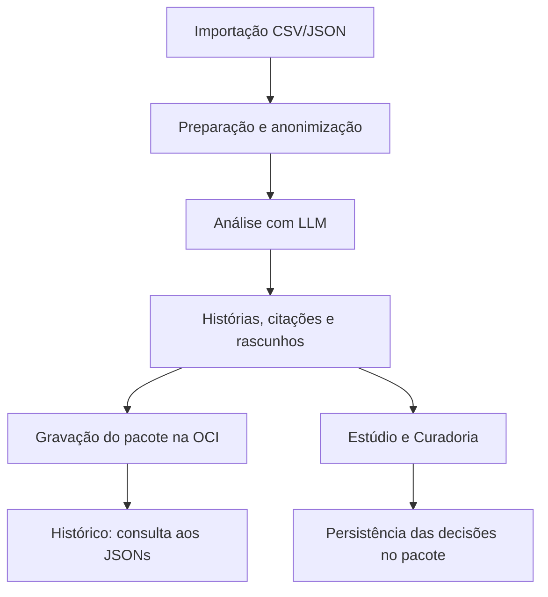

# CommunityLab


**Detector Inteligente de Histórias de Sucesso e Testemunhos com IA**  
**Hackathon ONE G10 — Equipe 18 | Oracle Next Education + Alura | Simulação No Country**

> **Situação em 22/11/2026:** fluxo demonstrado com dados fictícios, análise por LLM e armazenamento real na OCI. Apresentação do Demo Day aprovada pelo grupo. **Homologação funcional do MVP ainda pendente.** Integrações, revisões e retestes são acompanhados separadamente.

---

## 💡 Sobre o projeto

O **CommunityLab** utiliza Inteligência Artificial para identificar histórias de sucesso, conquistas profissionais, projetos relevantes e relatos de superação em interações de comunidades digitais. A proposta é transformar esses relatos em sugestões de testemunhos, cases e conteúdos para redes sociais, preservando evidências rastreáveis e submetendo o material à curadoria humana.

A ferramenta apoia equipes de marketing e gestores de comunidades. **A IA sugere; pessoas verificam, decidem e autorizam.** Não há publicação automática no escopo do MVP.

## 🎯 O problema

Relatos de conquistas e experiências relevantes ficam dispersos em históricos de conversas. Identificá-los, conferir fatos, localizar citações originais e convertê-los em conteúdo editorial exige trabalho manual e pode introduzir erros de interpretação, atribuição ou consentimento.

## 🚀 Objetivo e escopo do MVP

Demonstrar um fluxo que permita:

1. Importar interações por **CSV ou JSON**.
2. Preparar e analisar dados para identificar histórias relevantes.
3. Gerar sugestões de ativos de conteúdo com auxílio de **LLM**.
4. Associar citações verificadas às **interações de origem**.
5. Revisar fatos, conteúdo editorial e autorização de divulgação **separadamente**.
6. Persistir e recuperar pacotes no **OCI Object Storage**, quando a integração estiver validada.
7. Demonstrar pelo menos três casos de uso com dados fictícios ou autorizados.

**Fora do escopo inicial:** captura direta obrigatória de Discord/Slack, publicação automática, monitoramento em tempo real e dashboards avançados.

## 🎬 Demonstração e apresentação

[Assistir à demonstração do CommunityLab](https://youtu.be/y0ZyTRXie10).

A apresentação final, com slides, demonstração e locução, tem **4min55s** e foi aprovada pelo grupo em 21/11 (Card 25). Essa versão foi compartilhada com a equipe; não se afirma que substituiu o vídeo do link acima.

A rodada demonstrada em 20/11 usou três mensagens fictícias: o Gemini retornou três histórias e seis ativos nos formatos **Post para LinkedIn** e **Card de conquista**. A demonstração incluiu edição, Curadoria e consulta aos dois JSONs no Histórico. Esses formatos não comprovam automaticamente a geração de Testemunho estruturado e Case de sucesso.

## 📌 Estado das entregas

Situação conferida em **22/11/2026**. Código integrado, implantação e aceite funcional são etapas distintas.

| Componente | Situação | Evidência / limite |
|---|---|---|
| Análise com LLM | Fluxo demonstrado com Gemini e Cohere | Gemini, Cohere e Groq configuráveis. Falha técnica não deve produzir histórias fictícias como resultado real. |
| OCI Object Storage | Gravação, leitura e regravação sem duplicidade comprovadas nos casos registrados | PR #43. Evidências de bucket privado, IAM e condições gratuitas continuam no Card 18. |
| Curadoria persistida | PR #57 integrado em `4beccce` | Grava decisões e campos editados; reteste funcional após implantação pendente. |
| VM OCI | Última evidência registrada: `4beccce`, contêiner saudável e spaCy sem fallback | Implantação das integrações posteriores ainda não confirmada. |
| Horário no Histórico | PR #56 integrado | Exibição em São Paulo; instantes e identificadores UTC preservados. |
| Conferência por citação nas telas | PR #59 integrado em `d703feb` | Conferência por origem e revalidação após edição; reteste visual na VM pendente. |
| Rótulo de análise real | PR #60 integrado em `b6ff760` | Reconhece Gemini/Cohere/Groq. Provedor não determina natureza dos dados; reteste na VM pendente. |
| Resposta truncada e nova tentativa | PR #61 integrado em `f6dd880` | Trata MAX_TOKENS e permite nova tentativa sobre o mesmo lote. Reteste na VM pendente; não garante sucesso da tentativa seguinte. |
| Natureza declarada no pacote | PR #62 integrado em `d033d5a` | Pacote principal 1.1 com ficticios/reais/nao_informado; evidencias.json permanece 1.0. |
| Declaração na Importação e selo nas Histórias | PR #63 integrado em `04ec8c6` | Dependência do #62 resolvida; reteste declaração → pacote OCI → selo pendente. |
| Fidelidade do exemplo hist-001 | PR #66 integrado em `5cc9e2e` | Descrição e ativo limitados ao que a citação sustenta; citação preservada. |
| Correção de anonimização | PR #64 integrado em `fcc077e`, após aprovação de Tissiany | Revisora relatou 3.682 testes aprovados e verificações locais com modelo real e fallback. O fallback apresentou falsos positivos em palavras comuns, cidades e termos técnicos. Implantação e reteste na VM pendentes. |
| Cases de sucesso — Card 14 | PR #67 aberto para revisão | Proposta extrativa; 3.709 testes locais aprovados. Sem validação real de IA/OCI nesta entrega. |
| Testemunhos estruturados — Card 13 | PR #68 aberto para revisão, baseado no #67 | Título, descrição e citação rastreados; 3.729 testes locais incluindo os cases. Integrar #67 antes de ajustar a base do #68 para main. |
| Recuperação editorial em nova sessão | Pendente, sem PR identificado na última conferência | Consulta ao JSON não comprova restauração completa de textos editados e decisões. |
| Apresentação final | Aprovada pelo grupo; Card 25 concluído | Não encerra a homologação funcional do MVP, acompanhada no Card 23. |

Os resultados de suítes informados nos PRs pertencem às respectivas versões e ambientes. Não devem ser somados nem apresentados como uma única execução da versão implantada.

## 🏗️ Arquitetura funcional

O caminho observado no aplicativo é:



A interface usa serviços em `app/services`. A presença de módulos em `src` não comprova que todos participam do fluxo do app. A conciliação entre modelos canônicos, projeções da interface e envelope permanece acompanhada nos Cards 02/05/24.

### Interface Streamlit

A interface contempla seis módulos: **Dashboard**, **Importação**, **Histórias**, **Estúdio de Conteúdo**, **Curadoria** e **Histórico**. O estado da aplicação utiliza `st.session_state`, e a camada `app/services/data_service.py` concentra chamadas a serviços e, quando aplicável, comportamentos demonstrativos.

### Integração com IA e evidências

A integração Gemini está incorporada à `main`. As histórias podem conter `citacoes` (com trecho e `id_interacao`), `interacoes_origem` e `relevancia_nivel` (`alta`, `media`, `baixa`). O mecanismo de citação confere trechos contra o **texto efetivamente recebido**; não usa o texto inventado pelo modelo como fonte de verdade. Isso **não dispensa validação factual humana**.

### Curadoria: três decisões independentes

- **Validação factual:** examina a suficiência e consistência das evidências; contradições precisam impedir liberação indevida.
- **Aprovação editorial:** avalia a qualidade e adequação do texto gerado.
- **Autorização de divulgação:** registra separadamente o consentimento ou a base autorizativa aplicável ao uso público.

**RG-01:** fatos e citações devem ser rastreáveis às fontes.  
**RG-02:** contradições não podem resultar em aprovação factual indevida.  
**RG-03:** aprovação editorial não substitui autorização para publicação.

A aplicação dessas regras no fluxo completo será verificada pelo CATP.

### OCI Object Storage

A gravação e a consulta reais de `pacote-distribuicao.json` e `evidencias.json` foram demonstradas pelo Histórico. O PR #43 registra gravação, leitura e regravação sem duplicidade. Os objetos são organizados por lote.

O PR #57 acrescenta decisões de curadoria e campos editados ao pacote existente. Sua integração não inclui a recuperação completa do lote pelo Histórico em uma nova sessão. Concorrência entre curadores, hidratação condicional e seleção do pacote permanecem limitações registradas.

Dados demonstrativos e operações reais devem ser distinguíveis. **Nenhum status de sucesso deve ser atribuído a uma gravação que não ocorreu.**

#### Configuração de credenciais OCI

Para a VM com Docker, siga o [guia de implantação](docs/DEPLOYMENT_ORACLE_VM.md): a pasta `.oci/` é montada somente para leitura em `/run/oci`. O arquivo de configuração deve apontar para a chave dentro do contêiner. Variáveis OCI no `.env` não substituem esse arquivo no Compose.

O serviço também suporta:

1. **Streamlit Secrets** (recomendado para deploy no Streamlit Cloud):
   - Configure as cinco variáveis em `.streamlit/secrets.toml` (desenvolvimento local) ou em **Settings > Secrets** do app publicado.
   - Variáveis: `OCI_USER`, `OCI_FINGERPRINT`, `OCI_TENANCY`, `OCI_REGION`, `OCI_KEY_CONTENT`.
   - Use `.streamlit/secrets.toml.example` como referência (apenas os NOMES das variáveis, sem valores reais).
   - Quando secrets estão presentes, o sistema usa apenas eles, sem fallback silencioso para o arquivo de config.

2. **Arquivo ~/.oci/config** (fallback para desenvolvimento local):
   - Usado automaticamente quando Streamlit secrets não estão disponíveis.
   - Configure conforme a documentação oficial da OCI.

**Importante:** `secrets.toml` está no `.gitignore` e nunca deve ser commitado. Defina um sal secreto próprio em `SAL_PSEUDONIMIZACAO`; o Docker Compose exige esse valor e não inicia sem ele. Preserve o sal entre implantações para manter os pseudônimos estáveis.

## 🛠️ Tecnologias

| Tecnologia | Utilização |
|---|---|
| Python | Lógica de aplicação, ingestão e serviços |
| Streamlit | Interface de exploração e curadoria |
| Gemini (LLM) | Análise e geração de histórias e conteúdos |
| Pandas / Pydantic | Preparação e validação estruturada no pipeline, conforme integração |
| OCI Python SDK | Comunicação com Oracle Cloud |
| OCI Object Storage | Persistência de pacotes |
| pytest | Testes automatizados e de regressão |
| GitHub | Código, Pull Requests e revisões |
| Trello | Planejamento e acompanhamento do projeto |

## 📁 Organização e documentação

Os diretórios relevantes incluem:

```text
README.md
READMEFrontend.md          # documentação específica do front-end, quando disponível
requirements-front.txt     # dependências do front-end
app/                       # Streamlit, telas, estado, serviços e mocks
src/                       # módulos do pipeline, conforme PRs integrados
docs/
  CATP_TEST_PLAN.md        # critérios e cenários de aceitação
```

A estrutura pode evoluir conforme os Pull Requests forem integrados. Para executar o front-end, consultar **`READMEFrontend.md`** e **`COMO_RODAR.md`**, quando disponíveis na branch utilizada. Não incluir chaves de API nem arquivos `.env` reais em commits.

## 🧪 Testes e critérios de aceitação

O plano está em [CATP_TEST_PLAN.md](docs/CATP_TEST_PLAN.md) e o histórico documental em [COMMUNITYLAB_HOMOLOGACAO_MVP.md](docs/COMMUNITYLAB_HOMOLOGACAO_MVP.md). Confrontar esses registros com os retestes posteriores no [Card 23](https://trello.com/c/dwxU4dBD).

- Há evidências de análise, citações, edição, controles humanos e gravação/consulta OCI em lotes fictícios.
- Permanecem pendentes a consolidação dos três cenários, dos formatos principais, dos vínculos de origem e da recuperação editorial em nova sessão.
- A correção de anonimização do PR #64 foi integrada em `fcc077e`, após aprovação de Tissiany. A revisora relatou 3.682 testes aprovados e verificações locais com modelo spaCy real e fallback forçado.
- Os nomes testados foram mascarados. No fallback, foram observados falsos positivos em palavras comuns, cidades e termos técnicos, como “Estudei SQL”, “Porto Alegre” e “Cloud Foundations”.
- Esses resultados locais não garantem anonimização completa nem substituem implantação e reteste pela interface.
- O caso de truncamento com seis interações é acompanhado na issue #58 e no PR #61, já integrado. Reteste na versão implantada permanece pendente.
- **Nenhum aceite geral do MVP é declarado neste README.**

Não interpretar commits, screenshots ou testes locais isolados como homologação automática.

## 🧪 Casos de demonstração

1. **Conquista profissional:** identificação de relato de obtenção de emprego; extração de fatos e proposta de testemunho.
2. **Projeto de destaque:** identificação de projeto tecnológico; extração de evidências e proposta de case.
3. **Superação e transição de carreira:** identificação de trajetória de desenvolvimento; proposta de testemunho e sugestão de post.

Usar somente dados fictícios ou autorizados e manter explícito o modo demonstração.

## 🔐 Segurança, privacidade e responsabilidade

- Nunca versionar senhas, tokens, credenciais OCI ou chaves de API.
- Utilizar configurações externas, como variáveis de ambiente, secrets ou arquivos locais ignorados pelo Git.
- Limitar o acesso a dados pessoais e aos objetos armazenados.
- Não tratar a anonimização automatizada como garantia absoluta de ausência de dados pessoais.
- Preservar a proveniência de citações e a possibilidade de auditoria.
- Manter revisão humana e autorização apropriada antes da divulgação pública.
- Diferenciar claramente resultados reais, dados simulados e falhas técnicas.

## 👥 Equipe

| Integrante | Responsabilidade |
|---|---|
| Marcus | Project Manager |
| Tissiany Delmiro | Full Stack Developer |
| Jaqueline de Lira | AI Engineer |
| Luciene Godoy | Agent Engineer |

## 🤝 Colaboração e governança

- Desenvolver em branches específicas (`feature/`, `feat/`, `fix/`, `docs/`, `chore/`).
- Adotar commits objetivos, preferencialmente em padrão **Conventional Commits**.
- Descrever escopo, impactos, testes e referências aos cards do Trello nos Pull Requests.
- Submeter mudanças à revisão técnica e respeitar a proteção da `main`, incluindo a aprovação exigida.
- Não realizar merge de funcionalidades críticas sem análise dos critérios de aceitação correspondentes.

## 🗺️ Próximas etapas

- [x] Disponibilizar fluxo demonstrável com análise por LLM e armazenamento OCI.
- [x] Integrar persistência de decisões de curadoria no pacote (#57).
- [x] Preparar e obter aprovação do grupo para a apresentação final (Card 25).
- [x] Integrar conferência de citações, rótulos dos provedores e nova tentativa após truncamento (#59, #60 e #61).
- [x] Integrar natureza declarada dos dados no pacote e nas telas (#62 e #63).
- [x] Corrigir a descrição do exemplo hist-001 conforme a citação (#66).
- [x] Revisar e integrar os ajustes de anonimização (#64).
- [ ] Confirmar implantação do #64 e retestar anonimização pela interface, incluindo as limitações do fallback.
- [ ] Revisar e integrar cases (#67) e testemunhos (#68), respeitando a dependência #67 → #68.
- [ ] Confirmar SHA e saúde da versão consolidada implantada na VM.
- [ ] Retestar citações, provedores, truncamento, natureza declarada e persistência editorial pela interface.
- [ ] Validar contratos e os formatos principais com IA e OCI reais, usando dados fictícios.
- [ ] Validar recuperação completa de textos e decisões em nova sessão.
- [ ] Completar as evidências de configuração OCI do Card 18.
- [ ] Consolidar CATP, evidências e aceite expresso no Card 23.
- [ ] Conciliar README, documentação do front, diagrama e relatório com a implementação.
- [ ] Conferir os arquivos e links finais enviados à plataforma.

## 📈 Resultados esperados

Ao final do hackathon, espera-se demonstrar a capacidade de identificar histórias relevantes, gerar sugestões editoriais rastreáveis, permitir curadoria responsável e recuperar ativos armazenados, com documentação e evidências de testes suficientes para avaliar o funcionamento do MVP.

## 📄 Licença e créditos

A licença será definida pela equipe, conforme as regras do Hackathon e a estratégia de disponibilização do código.

**CommunityLab — Histórias que inspiram. Inteligência que transforma.**  
Hackathon ONE G10 — Oracle Next Education & Alura · Equipe 18  
**Prazo exibido na plataforma No Country na evidência de 20/11:** 22 de novembro de 2026, às 23h59. Fuso da plataforma a confirmar.