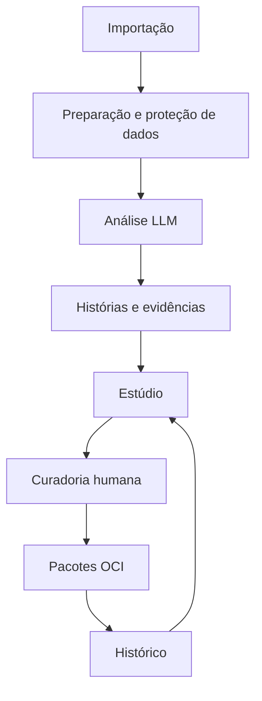

# CommunityLab

**Community Intelligence & Marketing Enablement**

Inteligência artificial aplicada à identificação de histórias de sucesso, gestão de evidências e produção responsável de conteúdo.

Projeto desenvolvido no Hackathon ONE G10 — Equipe 18 | Oracle Next Education, Alura e simulação No Country.

> MVP em evolução. Homologação operacional integral pendente. A IA sugere; pessoas verificam, decidem e autorizam.

## Problema e proposta

Relatos relevantes ficam dispersos nas comunidades digitais. O CommunityLab auxilia equipes de marketing e gestores de comunidades a identificar conquistas, projetos e experiências de superação, transformando evidências em propostas editoriais rastreáveis. Não realiza publicação automática.

## Funcionalidades

- Importação CSV/JSON e preparação de interações.
- Análise com Gemini, Cohere ou Groq, conforme configuração e política de dados.
- Histórias, citações vinculadas à origem, posts, cards, cases e testemunhos estruturados.
- Estúdio de conteúdo e curadoria humana, com validação factual, aprovação editorial e autorização de divulgação separadas.
- Persistência de pacotes e recuperação editorial pelo Histórico, com OCI Object Storage quando configurado.

## Arquitetura



A interface Streamlit utiliza serviços em `app/services` e estado de sessão. Os módulos do pipeline ficam em `src`. O diagrama é funcional, não uma garantia de cobertura de todos os módulos.

## Estado das entregas — 25/11/2026

| Entrega | Situação |
|---|---|
| Cases e testemunhos estruturados | Integrados (#67, #68) |
| Isolamento de lotes e proveniência | Integrado (#80) |
| Proteção de credenciais | Integrada (#81) |
| Avisos de edição de cases | Integrados (#82) |
| Privacidade e governança de provedores | Integradas (#83) |
| Dependências uv | Integradas (#84) |
| Centralização de estado | Integrada (#85) |
| Refatoração e diagnósticos | PR #86 em revisão |
| Ajustes de evidências e curadoria | PR #87 em revisão |

Integração de código não equivale a implantação ou aceite operacional. Consulte o [Card 23](https://trello.com/c/dwxU4dBD) para evidências e pendências.

## Instalação e configuração

#### Dependências e versões de Python

As dependências de execução ficam em `[project.dependencies]` do `pyproject.toml`, incluindo o modelo `pt_core_news_sm` do spaCy (instalado por URL, na mesma série 3.8 do spaCy). O intervalo de Python é `>=3.11,<3.13`, declarado em `[project].requires-python`. O arquivo `uv.lock` fixa as versões resolvidas e deve ser versionado.

Para atualizar dependências, edite o `pyproject.toml`, rode `uv lock` e faça o commit dos dois arquivos. Para rodar localmente: `uv sync --extra dev` e `uv run streamlit run app/main.py`.

No Streamlit Community Cloud, o gerenciador usado é o primeiro arquivo de dependências encontrado, na ordem `uv.lock`, `Pipfile`, `environment.yml`, `requirements.txt` e `pyproject.toml`. Por isso o repositório não deve conter `requirements*.txt`, `Pipfile` nem `environment.yml`. Selecione Python 3.11 ou 3.12 nas configurações do app.

Na VM, o Dockerfile usa Python 3.11 e instala o projeto com `pip install .`, via setuptools. Esse fluxo não lê o `uv.lock`.

#### Configuração de credenciais OCI

Para a VM com Docker, siga o [guia de implantação](docs/DEPLOYMENT_ORACLE_VM.md): a pasta `.oci/` é montada somente para leitura em `/run/oci`. O arquivo de configuração deve apontar para a chave dentro do contêiner. Variáveis OCI no `.env` não substituem esse arquivo no Compose.

O serviço também suporta:

1. **Streamlit Secrets** (recomendado para deploy no Streamlit Cloud):
   - Configure as cinco variáveis em `.streamlit/secrets.toml` (desenvolvimento local) ou em **Settings > Secrets** do app publicado.
   - Variáveis: `OCI_USER`, `OCI_FINGERPRINT`, `OCI_TENANCY`, `OCI_REGION`, `OCI_KEY_CONTENT`.
   - Use `.streamlit/secrets.toml.example` como referência (apenas os NOMES das variáveis, sem valores reais).
   - Quando secrets estão presentes, o sistema usa apenas eles, sem fallback silencioso para o arquivo de config.

2. **Arquivo ~/.oci/config** (fallback para desenvolvimento local):
   - Usado automaticamente quando Streamlit secrets não estão disponíveis.
   - Configure conforme a documentação oficial da OCI.

**Importante:** `secrets.toml` está no `.gitignore` e nunca deve ser commitado. Defina um sal secreto próprio em `SAL_PSEUDONIMIZACAO`; o Docker Compose exige esse valor e não inicia sem ele. Preserve o sal entre implantações para manter os pseudônimos estáveis.


## Segurança e responsabilidade

Dados reais exigem política explícita de provedor e sal privado de pseudonimização. Dados de natureza desconhecida não devem ser enviados para análise real. Pseudonimização e mascaramento não garantem anonimização integral. Não versione credenciais, chaves ou dados pessoais. Preserve a revisão humana e a autorização de divulgação.

Veja [privacidade e segurança](docs/security/privacy-hardening.md).

## Testes e demonstração

```bash
uv sync --extra dev
uv run python -m pytest -q
```

[Vídeo demonstrativo](https://youtu.be/y0ZyTRXie10) · [Plano CATP](docs/CATP_TEST_PLAN.md) · [Histórico de homologação](docs/COMMUNITYLAB_HOMOLOGACAO_MVP.md).

A demonstração de 20/11 utilizou dados fictícios, Gemini e OCI. Resultados de testes pertencem aos respectivos commits e ambientes; não representam aceite geral do MVP.

## Próximas etapas

- Revisar e integrar os PRs pendentes.
- Confirmar versão implantada e saúde da VM.
- Retestar três cenários, formatos editoriais, proteção de dados e recuperação de lotes.
- Consolidar evidências OCI, CATP e aceite expresso.
- Definir licença e estratégia de disponibilização com a equipe.

## 👥 Equipe

| Integrante | Responsabilidade |
|---|---|
| Marcus | Project Manager |
| Tissiany Delmiro | Full Stack Developer |
| Jaqueline de Lira | AI Engineer |
| Luciene Godoy | Agent Engineer |

## Colaboração e licença

Utilize branches específicas, Conventional Commits e revisão independente antes de integrar à main. A licença será definida pela equipe; não se presume autorização de exploração comercial.

**CommunityLab — Histórias que inspiram. Inteligência que transforma.**
