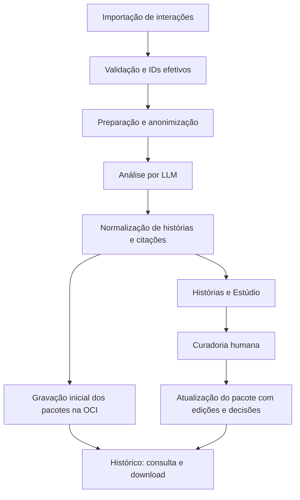

# Arquitetura do CommunityLab

Detector Inteligente de Histórias de Sucesso e Testemunhos com IA.

## Referência desta documentação

Descrição baseada no código integrado à `main` em **22/11/2026**, commit `fcc077e`, que inclui a correção de anonimização do PR #64.

Esta documentação descreve o fluxo implementado. Não comprova que essa versão já foi implantada na VM nem substitui a homologação funcional.

Os PRs #67 e #68, referentes a cases e testemunhos estruturados, permanecem em revisão nesta referência.

## 1. Visão geral

A aplicação utiliza Streamlit para importação, acompanhamento do processamento, exploração de histórias, edição de conteúdos, curadoria e consulta ao armazenamento.

As telas acessam os serviços por `app/services/data_service.py`. A análise utiliza `app/services/llm.py` e `app/services/llm_provider.py`; o armazenamento utiliza `app/services/oci_storage.py`.

Os módulos de `src/` possuem responsabilidades próprias e alguns são reutilizados pelo aplicativo. Sua presença no repositório não significa que todos sejam executados sequencialmente pelo fluxo Streamlit.

## 2. Fluxo do aplicativo



A gravação inicial acontece durante o processamento. A curadoria pode atualizar posteriormente o pacote com campos editados e decisões.

O Histórico permite consultar e baixar os objetos disponíveis. Não há, nesta referência, comprovação de recuperação editorial completa do lote em uma nova sessão.

## 3. Componentes e responsabilidades

| Componente | Responsabilidade |
|---|---|
| `app/main.py` | Entrada do aplicativo, navegação e roteamento das telas. |
| `app/state.py` | Estado da sessão e controles compartilhados. |
| `app/telas/importacao.py` | Carregamento das interações, prévia e declaração da natureza dos dados. |
| `app/telas/processamento.py` | Coordenação do processamento, tratamento de erros e gravação inicial. |
| `app/telas/historias.py` | Exploração das histórias e exibição da natureza declarada. |
| `app/telas/estudio.py` | Consulta às evidências e edição dos ativos disponíveis. |
| `app/telas/curadoria.py` | Validação factual, decisão editorial e autorização de publicação. |
| `app/telas/historico.py` | Listagem, visualização e download dos pacotes OCI. |
| `app/services/data_service.py` | Camada de acesso das telas aos serviços e montagem dos pacotes. |
| `app/services/llm.py` | Preparação das entradas, interpretação da resposta e normalização das histórias. |
| `app/services/llm_provider.py` | Chamadas aos provedores e tentativa dos provedores seguintes em caso de indisponibilidade ou falha. |
| `app/services/conferencia_citacao.py` | Conferência dos trechos contra suas interações de origem. |
| `app/services/oci_storage.py` | Gravação, leitura e listagem de objetos no OCI Object Storage. |
| `src/preprocessing/` | Funções de preparação textual e anonimização reutilizadas na análise. |

O Dashboard apresenta contagens e navegação. Não equivale ao painel analítico avançado previsto no Card 22.

## 4. Entrada e identidade das interações

O aplicativo recebe arquivos CSV, JSON colado e, quando configurado, mensagens do Discord.

As interações utilizadas pelas telas possuem campos como:

- `autor`
- `canal`
- `tipo`
- `texto`
- `id`, quando fornecido

O ID efetivo é calculado antes dos filtros:

1. Utiliza o ID explícito quando é inteiro positivo, excluindo booleanos.
2. Utiliza a posição original quando o ID está ausente ou inválido.
3. Registra avisos para IDs substituídos.
4. Rejeita colisões de IDs efetivos.
5. Preserva os identificadores após filtros.

O identificador do lote distingue execuções. Reprocessamento e regravação devem preservar a rastreabilidade correspondente à operação.

## 5. Preparação e anonimização

Antes da chamada ao LLM, o serviço aplica normalização e anonimização ao texto. O autor é pseudonimizado.

Dados reconhecidos podem ser substituídos por marcadores:

- `[NOME]`
- `[EMAIL]`
- `[TELEFONE]`
- `[CPF]`

A imagem Docker instala e valida o modelo `pt_core_news_sm`. Sem o modelo, existe fallback heurístico de melhor esforço.

### Correção do PR #64

Integrada em `fcc077e`, após aprovação de Tissiany.

A revisora relatou 3.682 testes aprovados no head `f929124`, além de verificações locais com modelo real e fallback forçado.

Os nomes testados foram mascarados. No fallback, foram observados falsos positivos em palavras comuns, cidades e termos técnicos, como “Estudei SQL”, “Porto Alegre” e “Cloud Foundations”.

Esses resultados não garantem anonimização completa. Implantação e reteste pela interface continuam pendentes.

Para uso de mensagens reais, é necessário confirmar a disponibilidade do modelo ou encaminhar o conteúdo para revisão humana antes do envio ao provedor.

## 6. Análise por LLM

O serviço tenta os provedores nesta ordem:

**Gemini → Cohere → Groq**

A tentativa depende das credenciais configuradas e das respostas dos provedores.

O fluxo solicita informações como classificação, histórias, fatos, resultados, destaques e ativos. A resposta passa por interpretação e normalização antes de ser apresentada.

### Tratamento de falhas

- Falha em todos os provedores gera erro de análise.
- Resposta inválida não deve ser substituída por histórias fictícias.
- Resposta encerrada com `MAX_TOKENS` recebe tratamento específico de truncamento.
- A interface permite nova tentativa sobre o mesmo lote.
- A nova tentativa não garante sucesso.
- A ação Regenerar do Estúdio alterna variações já disponíveis; não realiza nova chamada ao LLM.

Não há, neste fluxo, comprovação de que todos os módulos de análise, detecção, extração e geração presentes em `src/` sejam executados como etapas independentes.

## 7. Histórias, evidências e ativos

As histórias normalizadas podem conter:

- Identificador da história.
- Autor pseudonimizado.
- Categoria, sentimento e relevância.
- Mensagem de origem preparada.
- Fatos e resultados.
- Citações vinculadas por `id_interacao`.
- Lista `interacoes_origem`.
- Ativos com campos editáveis.

Os destaques utilizados como citações são localizados na fonte correspondente. O texto retornado pelo modelo não é aceito, por si só, como prova de origem.

### Conferência nas telas

A conferência ocorre por citação e distingue:

- Trecho literal conferido.
- Compatibilidade com anonimização.
- Incompatibilidade com motivo.
- Origem indisponível, inválida ou ambígua.

O campo de citação editável é reconferido após alterações.

Compatibilidade com anonimização não confere o dado ocultado. A correspondência literal não comprova a fidelidade contextual de toda a narrativa nem autoriza publicação.

### Formatos

| Formato | Situação nesta referência |
|---|---|
| Post para LinkedIn e card de conquista | Presentes no fluxo existente e na demonstração registrada. |
| Case de sucesso | Proposta extrativa no PR #67, em revisão. |
| Testemunho estruturado | Proposta no PR #68, em revisão e baseada no #67. |
| Newsletter | Não apresentada como formato comprovado no fluxo atual. |

Após integrar o #67, a base do #68 deve ser ajustada para `main` e o diff deve ser reconferido.

A existência de um helper de conversão canônica não comprova exportação automática integrada.

## 8. Natureza declarada dos dados

A pessoa declara a natureza do lote na Importação:

- `ficticios`
- `reais`
- `nao_informado`

O padrão é `nao_informado`. Um lote novo reinicia a declaração, e o controle fica travado após o início do processamento daquele lote.

O selo nas Histórias representa a declaração, sem inferência pelo conteúdo, origem ou provedor.

**Limitação conhecida:** a nota “Exemplo fictício…” da Importação ainda depende da origem do lote.

## 9. Curadoria humana

O aplicativo separa três decisões:

1. **Validação factual.**
2. **Curadoria editorial.**
3. **Autorização de publicação.**

Aprovação editorial não equivale a autorização de divulgação. Uma contradição não resolvida impede a aprovação pelo controle correspondente da interface.

O indicador de liberação depende dos três controles. Mesmo quando exibido, não há publicação automática.

O PR #57 integrou a persistência de decisões e campos editados no pacote. O reteste funcional na versão consolidada continua pendente.

## 10. Persistência no OCI

O aplicativo utiliza `app/services/oci_storage.py`, acessado pela camada de serviços.

Os objetos do lote são organizados em:

```text
ativos/<lote_id>/<arquivo>.json
```

Os arquivos principais são:

- `pacote-distribuicao.json`
- `evidencias.json`

O pacote principal utiliza versão **1.1**, incluindo a natureza declarada. O arquivo de evidências permanece na versão **1.0**.

Regravar o mesmo lote e arquivo utiliza o mesmo caminho. A gravação, leitura e regravação sem duplicidade foram comprovadas nos casos registrados pelo PR #43.

### Falhas e confirmação

- Sem credenciais ou acesso válido, a operação não deve ser apresentada como gravação real bem-sucedida.
- Falhas devem manter o motivo disponível.
- Simulações visuais não comprovam operações no bucket.
- Consulta e download não equivalem à restauração editorial completa.

### Autenticação e infraestrutura

Consulte o [guia de implantação na VM Oracle](../DEPLOYMENT_ORACLE_VM.md).

A configuração efetiva de autenticação depende do ambiente. Credenciais, chaves privadas e arquivos reais de secrets não devem ser versionados.

As evidências de bucket privado, permissões, acesso negado e condições gratuitas da conta continuam acompanhadas no Card 18.

## 11. Contratos e módulos de src

O repositório possui módulos em `src/` para ingestão, preparação, análise, detecção, extração, geração, orquestração e armazenamento.

Esses módulos devem ser avaliados conforme suas chamadas e contratos reais. Não devem ser representados como uma cadeia integralmente utilizada pelo aplicativo apenas por existirem no repositório.

A conciliação entre:

- Modelos canônicos.
- Estruturas utilizadas pelas telas.
- Envelope persistido.
- Conversores e formatos dos ativos.

continua acompanhada nos Cards 02, 05 e 24.

Consulte o [contrato de integração do Card 05](../CARD05_CONTRATOS_INTEGRACAO.md).

## 12. Implantação e homologação

A referência desta documentação é o código da `main` em `fcc077e`.

A última evidência de implantação anteriormente registrada apontava para `4beccce`, com contêiner saudável e spaCy carregado sem fallback. Ela não comprova implantação das integrações posteriores.

Para concluir a homologação:

- Confirmar o SHA implantado e a saúde do serviço.
- Retestar anonimização com dados fictícios.
- Conferir citações e revalidação após edição.
- Verificar identificação dos provedores e tratamento de truncamento.
- Conferir declaração → pacote OCI → selo.
- Validar persistência das edições e decisões.
- Validar os formatos principais após integração.
- Verificar recuperação editorial em nova sessão.
- Consolidar evidências e aceite no Card 23.

Código integrado, serviço disponível e aceite funcional são verificações distintas.

## 13. Referências

- [README principal](../../README.md)
- [Documentação do front-end](../../READMEFrontend.md)
- [Contrato de integração](../CARD05_CONTRATOS_INTEGRACAO.md)
- [Guia de implantação](../DEPLOYMENT_ORACLE_VM.md)
- [Plano CATP](../CATP_TEST_PLAN.md)
- [Histórico de homologação](../COMMUNITYLAB_HOMOLOGACAO_MVP.md)

A atualização documental não encerra os critérios dos Cards 02, 23 ou 24 sem as validações correspondentes.